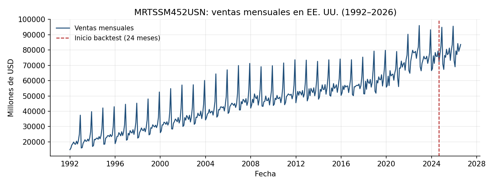
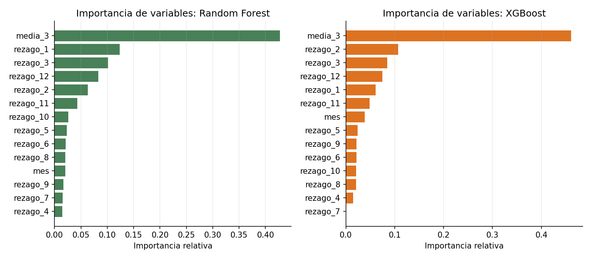
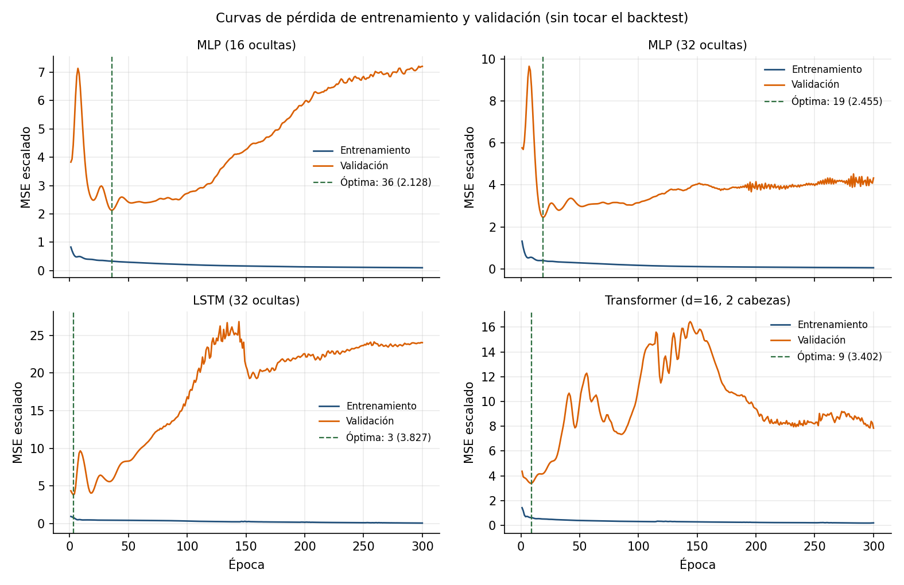
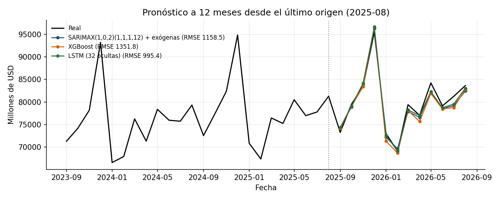

# Informe del miniproyecto 2

## 1. La serie y el modelo a superar

La serie analizada es **MRTSSM452USN**, correspondiente a las ventas mensuales de tiendas de mercancías generales en Estados Unidos, sin ajuste estacional, expresadas en **millones de dólares estadounidenses** (fuente: *U.S. Census Bureau*, distribuida por FRED). Cuenta con **416 observaciones** mensuales desde **enero de 1992 hasta agosto de 2026**, con periodicidad estacional $s=12$, **cero valores faltantes** y **cero fechas duplicadas**. Se conserva exactamente la decisión de `preparar` del miniproyecto 1: no se imputan datos ni se recortan los valores extremos observados, ya que reflejan variaciones económicas reales.

El mejor modelo clásico del miniproyecto 1 fue **SARIMAX$(1,0,2)(1,1,1)_{12}$ con exógena de calendario** (`dias_lunes_viernes`, número de días hábiles de lunes a viernes de cada mes). Su ecuación multiplicativa es:

$$(1 - \phi_1 B)(1 - \Phi_1 B^{12})(1 - B^{12})\bigl(Y_t - \beta X_t\bigr) = (1 + \theta_1 B + \theta_2 B^2)(1 + \Theta_1 B^{12})\varepsilon_t,$$

donde $X_t$ representa los días de lunes a viernes del mes $t$, conocidos con anticipación sin fuga de información. Al migrar exactamente `preparar`, `exogenas`, `ajustar` y `modelo_sarimax` al *backtest* común (13 orígenes móviles sobre los últimos 24 meses, horizonte $h=1,\ldots,12$), se reprodujeron de forma idéntica las métricas del miniproyecto 1: **RMSE = 1082,02**, **MAE = 890,76** y **MAPE = 1,16 %** (frente a **RMSE = 2181,36**, **MAE = 1904,40** y **MAPE = 2,44 %** del estacional ingenuo).

## 2. La tabla supervisada

Para construir la tabla supervisada (`tabla_supervisada`) se eligió **`OBJETIVO = "dif12"`**, definido como la diferencia estacional a 12 meses:

$$z_t = y_t - y_{t-12}.$$

Esta elección se justifica directamente con los resultados del miniproyecto 1: la prueba ADF sobre la serie original con tendencia (`regression="ct"`) no rechazó la raíz unitaria ($p = 0{,}099675$), mientras que la diferencia estacional de orden 12 sí la rechazó ($p = 0{,}000175$), eliminando además la tendencia creciente (de 20.015,40 a 80.982,93 millones de dólares) y la estacionalidad anual dominante (pico promedio en diciembre de +18.857,60 millones). Trabajar sobre $z_t$ evita que los modelos basados en árboles y vecinos cercanos tengan que extrapolar niveles crecientes fuera del rango histórico.

Cada fila $t$ contiene **14 variables explicativas**:

- **Rezagos 1 a 12** de la serie diferenciada: $x_{t,k} = z_{t-k}$ para $k \in \{1,\ldots,12\}$, calculados con `z.shift(k)`.
- **Mes del año**: $m_t \in \{1,\ldots,12\}$, extraído del índice temporal (`z.index.month`).
- **Media móvil de los 3 meses previos**: $\bar{z}_{t-1}^{(3)} = \frac{1}{3}(z_{t-1} + z_{t-2} + z_{t-3})$, calculada con desplazamiento previo `z.shift(1).rolling(3).mean()` para no incluir $z_t$.

De las **416 filas iniciales**, quedan **392 filas completas**; se pierden **24 filas** (12 por `diff(12)` y 12 adicionales por `rezago_12`). En el bloque previo al *backtest* (`serie.iloc[:-24]`, 392 meses) resultan **368 filas** de entrenamiento con media $\bar{z}=1747{,}30$ y desviación estándar $2066{,}10$ millones de dólares.

Para garantizar la ausencia de fuga de información, `comprobar_sin_fuga` recorre los **416 meses** uno por uno, altera tanto el valor de la serie original como el de $z_t$ en la fila $t$, y verifica mediante `np.array_equal(..., equal_nan=True)` que las 14 columnas de la fila $t$ permanecen idénticas (`Prueba sin fuga: OK (416/416 meses verificados sin cambios)`).

El pronóstico a 12 meses (`recursivo`) agrega el mes siguiente con `NaN`, construye su fila usando únicamente valores previos, predice $\hat{z}_t$ y reconstruye el nivel mediante:

$$\hat{y}_t = \hat{z}_t + y_{t-12},$$

incorporando $\hat{y}_t$ al historial antes de avanzar al horizonte siguiente (si el horizonte requiriera un valor estacional ya pronosticado, usaría dicha predicción y nunca el dato real futuro). En `con_tabla`, cada modelo (incluidos los `StandardScaler` dentro de los *pipelines* de KNN y SVR) se ajusta exclusivamente con `entrenamiento` dentro de cada origen del *backtest*.

## 3. Aprendizaje automático

La selección de hiperparámetros (`ajustar_hiperparametros`) se realizó únicamente sobre las **368 filas completas previas al *backtest*** (hasta agosto de 2024), usando `GridSearchCV` con `TimeSeriesSplit(n_splits=5)` y criterio `neg_root_mean_squared_error`. Los cinco pliegues crecientes abarcaron desde `1994-01..1999-03` (63 filas) hasta `1994-01..2019-07` (307 filas), validando en bloques consecutivos de 61 meses hasta `2024-08`. De este modo, **ninguno de los 24 meses del *backtest* (2024-09 a 2026-08) participa** en la elección.

Antes de fijar la rejilla de SVR, se verificó que `svr()` escala las variables de entrada $X$ mediante `StandardScaler`, pero **no escala el objetivo $z_t$** (que tiene desviación $2066{,}10$ y rango $[-4929{,}00;\; 11361{,}00]$), por lo que se evaluaron valores de $C \in \{100, 1000, 10000\}$ y $\varepsilon \in \{10, 100\}$.

| Modelo | Rejilla evaluada | Hiperparámetros elegidos | RMSE validación |
|---|---|---|---:|
| KNN | `n_neighbors`: `[3, 5, 9]` | `n_neighbors=9` | 1683,00 |
| SVR | `C`: `[100, 1000, 10000]`, `epsilon`: `[10, 100]` | `C=1000, epsilon=10` | 1844,43 |
| Random Forest | `max_depth`: `[4, 8, None]`, `min_samples_leaf`: `[1, 4]` | `max_depth=None, min_samples_leaf=1` | 1566,06 |
| XGBoost | `max_depth`: `[2, 4, 6]`, `learning_rate`: `[0.03, 0.1]` | `max_depth=2, learning_rate=0.03` | 1587,44 |

En ambos ensambles domina la memoria reciente de la diferencia interanual: en **Random Forest**, las cinco variables más importantes son `media_3` (0,4275), `rezago_1` (0,1234), `rezago_3` (0,1012), `rezago_12` (0,0828) y `rezago_2` (0,0630); en **XGBoost**, `media_3` (0,4611), `rezago_2` (0,1069), `rezago_3` (0,0847), `rezago_12` (0,0746) y `rezago_1` (0,0608). Esto coincide estrechamente con la **PACF de la diferencia estacional del miniproyecto 1**, donde sobresalían precisamente los rezagos **1, 2 y 3** (autocorrelaciones parciales de 0,64, 0,39 y 0,33) junto al rezago estacional **12**.

En el *backtest* común, **XGBoost** gana entre los cuatro modelos de aprendizaje automático en las tres métricas (**RMSE = 1112,38**, **MAE = 864,10**, **MAPE = 1,12 %**), seguido por **KNN** (**RMSE = 1152,96**, **MAE = 899,99**, **MAPE = 1,17 %**), **SVR** (**RMSE = 1205,28**, **MAE = 933,43**, **MAPE = 1,21 %**) y **Random Forest** (**RMSE = 1233,19**, **MAE = 951,60**, **MAPE = 1,24 %**).

## 4. Aprendizaje profundo

Se implementaron tres arquitecturas pequeñas en PyTorch, todas entrenadas mediante la clase `Red` con pérdida MSE, optimizador Adam ($\text{lr}=0{,}01$), semilla `2026` y escalado de entradas y objetivo ajustado únicamente con el entrenamiento de cada origen:

1. **MLP** (`MLP`): recibe las 14 columnas de la tabla supervisada, con una capa oculta ReLU y salida lineal escalar. Se compararon 16 neuronas (**257 parámetros**) y 32 neuronas (**513 parámetros**).
2. **LSTM** (`LSTM`): recibe la secuencia de los 12 rezagos ordenados del más antiguo al más reciente con forma `(lote, 12, 1)`, una capa `nn.LSTM(1, 32, batch_first=True)` y una capa lineal sobre el último estado oculto (**4513 parámetros**).
3. **Transformer pequeño** (`Transformer`): tercera red elegida para evaluar si la autoatención captura dependencias a lo largo de la ventana de 12 meses mejor que la recurrencia. Proyecta `(lote, 12, 1)` a dimensión $d=16$, suma codificación posicional sinusoidal, aplica una capa `nn.TransformerEncoderLayer` con 2 cabezas (`dim_feedforward=32`, `dropout=0.0`) y proyecta el último paso a un escalar (**2273 parámetros**).

La validación temporal se realizó con los **344 meses** previos (`1994-01` a `2022-08`) y los últimos **24 meses** anteriores al *backtest* (`2022-09` a `2024-08`) como bloque de validación. Las curvas muestran un sobreajuste temprano en todas las arquitecturas debido al tamaño reducido de la muestra de entrenamiento (344 observaciones frente a miles de parámetros): el entrenamiento sigue descendiendo hasta acercarse a cero, mientras que la pérdida de validación alcanza su mínimo pronto y luego asciende. Entre los MLP ganó **MLP (16 ocultas)** (MSE mínimo de validación `2,1284` en la época **36**, frente a `2,4551` en la época 19 para MLP de 32 ocultas). Para **LSTM (32 ocultas)** el mínimo se alcanzó en la **época 3** (`3,8274`) y para **Transformer** en la **época 9** (`3,4023`).

En el *backtest* con la semilla principal (`2026`), la mejor red fue **LSTM (32 ocultas)** con **RMSE = 1140,11** (**MAE = 901,46**, **MAPE = 1,17 %**), superando ampliamente a **MLP (16 ocultas)** (**RMSE = 1486,22**) y al **Transformer** (**RMSE = 1568,75**).

Al repetir **LSTM (32 ocultas)** con 3 épocas sobre cinco semillas en el *backtest* completo se obtuvieron:

| Semilla | RMSE | MAE | MAPE (%) |
|---|---:|---:|---:|
| 2026 | 1140,11 | 901,46 | 1,17 |
| 2027 | 1135,93 | 890,79 | 1,16 |
| 2028 | 1137,16 | 907,12 | 1,18 |
| 2029 | 1132,51 | 900,13 | 1,17 |
| 2030 | 1133,28 | 895,11 | 1,16 |

La media del RMSE entre las cinco semillas es **1135,80** y la desviación estándar muestral (`ddof=1`) es **3,07**. La diferencia respecto al modelo clásico SARIMAX ($1135{,}80 - 1082{,}02 = 53{,}78$ millones de dólares, o $58{,}09$ millones con la semilla principal) es **más de 17 veces mayor** que la desviación entre semillas, confirmando que la brecha frente al clásico es estructural y no producto del azar de inicialización.

## 5. La tabla y la elección

Tabla completa ordenada por RMSE ascendente (`resultados/metricas.csv`):

| Modelo | RMSE | MAE | MAPE (%) | Parámetros | Segundos |
|---|---:|---:|---:|---:|---:|
| SARIMAX(1,0,2)(1,1,1,12) + exógenas | 1082,02 | 890,76 | 1,16 | 7 | 4,9 |
| XGBoost | 1112,38 | 864,10 | 1,12 | 1364 | 1,5 |
| LSTM (32 ocultas), 3 épocas | 1140,11 | 901,46 | 1,17 | 4513 | 1,0 |
| KNN | 1152,96 | 899,99 | 1,17 | 5320 | 0,7 |
| SVR | 1205,28 | 933,43 | 1,21 | 5671 | 0,7 |
| Random Forest | 1233,19 | 951,60 | 1,24 | 47724 | 4,9 |
| MLP (16 ocultas), 36 épocas | 1486,22 | 1246,50 | 1,60 | 257 | 1,3 |
| Transformer (d=16, 2 cabezas), 9 épocas | 1568,75 | 1239,27 | 1,60 | 2273 | 1,6 |
| estacional ingenuo | 2181,36 | 1904,40 | 2,44 | 0 | 0,0 |

Ninguna red neuronal ni modelo de aprendizaje automático supera en RMSE al **SARIMAX$(1,0,2)(1,1,1)_{12}$ con exógenas**. Los datos del experimento explican con claridad por qué ocurre esto:

1. **Razón parámetros/datos y sobreajuste temprano**: el entrenamiento de las redes dispone de solo **344 observaciones** útiles tras diferenciar y rezagar, mientras que la LSTM ajusta **4513 parámetros** (~13,1 parámetros por observación) y el Transformer **2273 parámetros** (~6,6 por observación), frente a solo **7 parámetros** en SARIMAX. Como muestran las curvas de pérdida, la LSTM y el Transformer alcanzan su mínimo de validación en las épocas **3** y **9** respectivamente, sin margen para entrenar representaciones complejas sin memorizar el ruido.
2. **Error concentrado en febrero por efectos de calendario**: el análisis por mes (`resultados/errores_mes.csv`) muestra que el mes con mayor RMSE en los tres mejores modelos es **febrero** (**1632,01** en SARIMAX, **2107,63** en XGBoost y **1686,52** en LSTM). En los datos reales de la serie, febrero pasa de `67.880` millones en 2024 (año bisiesto, 29 días, `diff12 = +1485`) a `67.323` millones en 2025 (`diff12 = -557`) y `69.034` millones en 2026 (`diff12 = +1711`). SARIMAX incorpora directamente los días hábiles del mes como regresora exógena conocida, mientras que las tablas supervisadas y redes solo ven rezagos y el número de mes.

Cabe destacar que **XGBoost** logra el menor **MAE (864,10)** y **MAPE (1,12 %)** de toda la tabla, reduciendo el MAE respecto a SARIMAX en **2,99 %**, aunque su mayor error en febrero penaliza su RMSE cuadrático (+2,81 % frente a SARIMAX).

## 6. Conclusión

El modelo que pondríamos en producción es **SARIMAX$(1,0,2)(1,1,1)_{12}$ con días de lunes a viernes como exógena**. Es el ganador en RMSE (**1082,02** millones de dólares), reduciendo el error cuadrático en **50,40 %** frente al estacional ingenuo (**2181,36**) y en **2,73 %** frente al mejor modelo de aprendizaje automático (XGBoost, **1112,38**), además de superar en **5,09 %** a la mejor red neuronal (LSTM, **1140,11**).

Frente a las alternativas de aprendizaje automático y profundo, con SARIMAX se obtiene:

- **Menor requerimiento de datos y parsimonia extrema**: solo **7 parámetros** estimados sobre series de ~392–416 meses, sin riesgo de sobreparametrización ni necesidad de ajustar hiperparámetros por rejilla o épocas en cada ciclo.
- **Costo computacional bajo y determinista**: tarda **4,9 s** en todo el *backtest* (menos de 0,4 s por origen en CPU) y no depende de semilla aleatoria, frente a la sensibilidad o parada temprana forzada de las redes neuronales.
- **Máxima explicabilidad**: cada componente (autorregresivo, media móvil, estacional y efecto calendario de días hábiles) tiene interpretación económica directa, mientras que en las redes neuronales el pronóstico no es interpretable directamente y exige mantener escaladores y pipelines recursivos.

Si en el futuro se priorizara minimizar el error absoluto medio (MAE) en lugar de penalizar picos puntuales como febrero, **XGBoost** (**MAE = 864,10**, **1,5 s**, **1364 parámetros**) sería la alternativa más competitiva, especialmente si se le incorporara la misma variable de días hábiles del calendario.
